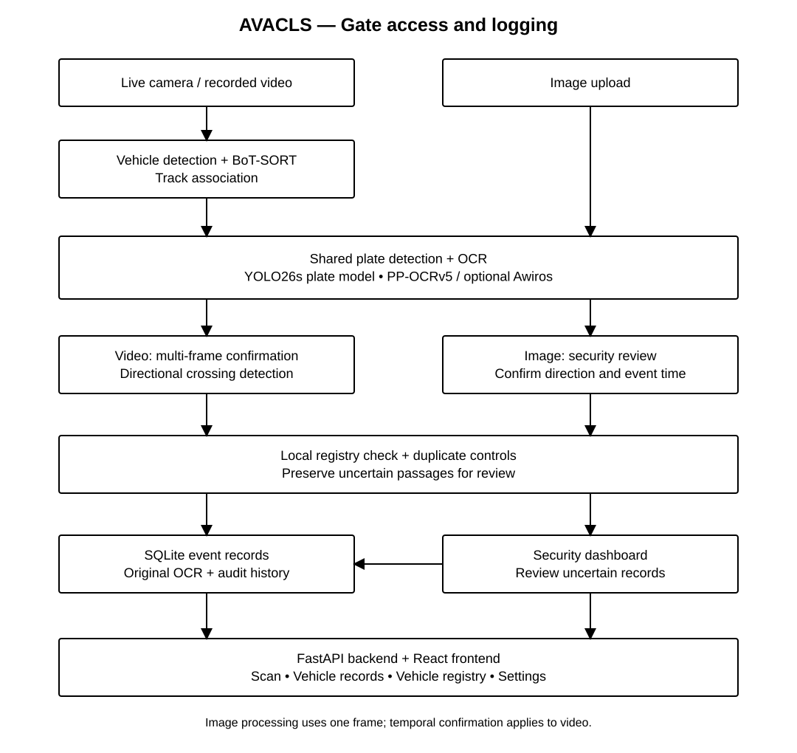
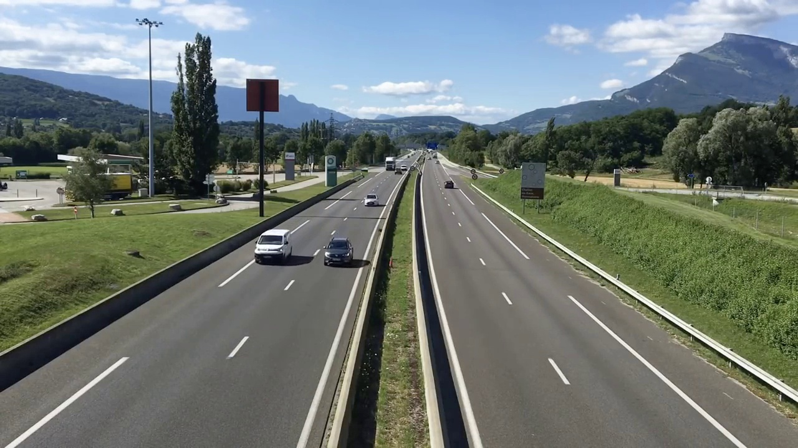
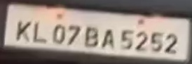

## Title of the Project
Automated Vehicle Access Control and Logging System for College Campuses (AVACLS)

A camera-based system that reads vehicle number plates, checks the campus vehicle registry, and records entry and exit events for security review.

## About
AVACLS supports live USB/RTSP camera input, recorded video replay, and image upload. Video processing detects and tracks vehicles, associates plate readings with each track, confirms readings across frames, and records directional gate crossings. Security can review uncertain readings and check vehicles against a local registration database.

This repository contains the application backend, frontend source and compiled frontend, runtime models, and one sample image. Research archives, training outputs, benchmark logs, obsolete frontend builds, and experimental model weights are excluded. The application covers gate entry and exit logging. It does not operate a physical barrier.

## Features
- Live camera capture and recorded video replay.
- Image upload using the shared plate recognition engine.
- YOLO26 vehicle and plate detection with BoT-SORT vehicle tracking.
- Multi-frame plate confirmation and directional crossing detection.
- Campus vehicle registry with registration status and validity checks.
- Entry/exit records, duplicate controls, and security review with audit history.
- Authentication, operator accounts, local storage, and backup tools.
- React dashboard with Scan, Vehicle records, Vehicle registry, and Settings pages.

## Requirements
* Operating System: 64-bit Windows or Linux. The saved verification used Linux; Windows and physical cameras still require device testing.
* Development Environment: Python **3.11 (64-bit)**. The setup script also accepts Python 3.12.
* Backend: FastAPI and Uvicorn. The packaged application uses **SQLite** locally; it needs no separate database server or Docker.
* Computer Vision: OpenCV, Ultralytics YOLO26, BoT-SORT, and PaddleOCR. The default vehicle model is YOLO26n; the plate model is the bundled Indian-plate YOLO26s model. Experimental profiles are included separately.
* OCR: Stock PP-OCRv5 is the default. The optional measured Awiros reader can be selected explicitly. Rejected experimental OCR weights are excluded from this package.
* Frontend: React and Vite. Node.js 22.12+ is required only to rebuild the frontend; a compiled distribution is included.
* Installation: Internet access for dependencies and sufficient space for model weights, videos, and locally generated records.

**Windows setup (PowerShell):**

```powershell
cd code
py -3.11 tools\setup.py
.\.venv\Scripts\python.exe tools\start.py
```

Open http://127.0.0.1:8000 and create the administrator account. Later, use `code/start.bat` to start the app.

**Linux setup:**

```bash
cd code
python3.11 tools/setup.py
.venv/bin/python tools/start.py
```

To select the optional measured Awiros reader, stop the application, run the following from `code/`, and restart:

```powershell
.\.venv\Scripts\python.exe tools\select_measured_reader.py --device cpu
```

The original configurations are backed up by the selector. CPU selection does not reproduce a GPU benchmark. Configure gate coordinates in `code/config/camera.json` before using a real gate camera. Use Image Upload with `code/samples/indian-input-frame-0.jpg`, or enter `0` in Live Video for the backend computer's first USB camera. Review uncertain readings before accepting records. Use one camera worker at a time.

**Frontend development (optional):**

```powershell
cd code
npm --prefix frontend ci
npm --prefix frontend run build
```

**Repository replacement:** Extract this ZIP and copy the contents of `Mainproject-phase-1/` into your existing local repository, preserving its `.git` directory. Replace the template README and placeholder `code/index.html` and `img/images.txt` with these files. Run Git from the repository root:

```bash
git add README.md LICENSE.txt code img
git commit -m "Add AVACLS application, runtime models and README"
git push origin main
```

The runtime models include a file larger than GitHub's browser upload limit. Use Git from your local terminal for the replacement. Model, dataset, and sample-media provenance is retained in `code/models/`, `code/docs/model-provenance/`, and `code/samples/`; third-party terms remain applicable.

## System Architecture


Video uses tracking, temporal confirmation, and directional crossing detection. Uploaded images use single-frame recognition followed by security review and operator-confirmed direction/time. Both routes check the same local vehicle registry and preserve event history. See [code/docs/ARCHITECTURE.md](code/docs/ARCHITECTURE.md).

## Output

#### Output1 - Recorded crossing evidence frame



Frame retained by the recorded-video pipeline. This public-road frame is evidence for review, not an independently verified correct crossing. 

#### Output2 - Plate crop retained for OCR development



Actual plate crop retained in the project evidence. Historical research archives are excluded from this smaller package. This image does not represent a new OCR accuracy run.

| Measurement | Saved result | Evaluation scope |
| --- | --- | --- |
| Awiros cropped-plate OCR | 148/184 (80.4%) | Held-out crops; excludes detection, tracking, and crossing failures |
| Fine-tuned PP-OCRv5 raw-crop OCR | 137/184 (74.5%) | Experimental reader; rejected as a replacement |
| Best expanded video development run | 19/24 (79.2%) | Selected development passages, provisional scorer |
| Repeated video configuration | 18/24 (75.0%) | Same configuration; shows run variability |

Full automatic campus-gate accuracy has not been established. The public-road samples are development material, not campus trials. These are historical checkpoint measurements, not a new test of this trimmed ZIP. Detailed benchmark archives are excluded.

## Results and Impact
AVACLS combines plate recognition, vehicle tracking, registration checks, and entry/exit records in one local application. It can reduce repeated manual record entry while allowing security to resolve uncertain readings. Original OCR readings and review history are retained for audit.

The saved evaluation demonstrates the implemented workflow and reports recognition results on specific development sets. Gate calibration, lighting, plate visibility, and hardware affect performance. A held-out evaluation covering all crossings is still needed before claiming general campus-gate accuracy.

The original repository license is retained in [LICENSE.txt](LICENSE.txt). Third-party weights, datasets, and media retain their own terms. The project source is based on the saved 29 October 2026 checkpoint. Packaging checks cover source syntax, model hashes, and required file references; the application and dependency installation were not executed again.

## Articles published / References
The following references are retained from the project's current paper. No publication claim is made here.

[1] C. N. E. Anagnostopoulos, I. E. Anagnostopoulos, I. D. Psoroulas, V. Loumos, and E. Kayafas, “License Plate Recognition From Still Images and Video Sequences: A Survey,” IEEE Transactions on Intelligent Transportation Systems, vol. 9, no. 3, pp. 377–391, 2008. doi: 10.1109/tits.2008.922938.

[2] S. Du, M. Ibrahim, M. Shehata, and W. Badawy, “Automatic License Plate Recognition (ALPR): A State-of-the-Art Review,” IEEE Transactions on Circuits and Systems for Video Technology, vol. 23, no. 2, pp. 311–325, 2013. doi: 10.1109/tcsvt.2012.2203741.

[3] J. Shashirangana, H. Padmasiri, D. Meedeniya, and C. Perera, “Automated License Plate Recognition: A Survey on Methods and Techniques,” IEEE Access, vol. 9, pp. 11203–11225, 2021. doi: 10.1109/access.2020.3047929.

[4] Lubna, N. Mufti, and S. A. A. Shah, “Automatic Number Plate Recognition: A Detailed Survey of Relevant Algorithms,” Sensors, vol. 21, no. 9, Art. no. 3028, 2021. doi: 10.3390/s21093028.

[5] S.-L. Chang, L.-S. Chen, Y.-C. Chung, and S.-W. Chen, “Automatic license plate recognition,” IEEE Transactions on Intelligent Transportation Systems, vol. 5, no. 1, pp. 42–53, 2004. doi: 10.1109/tits.2004.825086.

[6] C. N. E. Anagnostopoulos, I. E. Anagnostopoulos, V. Loumos, and E. Kayafas, “A License Plate-Recognition Algorithm for Intelligent Transportation System Applications,” IEEE Transactions on Intelligent Transportation Systems, vol. 7, no. 3, pp. 377–392, 2006. doi: 10.1109/tits.2006.880641.

[7] H. Li, P. Wang, M. You, and C. Shen, “Reading car license plates using deep neural networks,” Image and Vision Computing, vol. 72, pp. 14–23, 2018. doi: 10.1016/j.imavis.2018.02.002.

[8] H. Li, P. Wang, and C. Shen, “Toward End-to-End Car License Plate Detection and Recognition With Deep Neural Networks,” IEEE Transactions on Intelligent Transportation Systems, vol. 20, no. 3, pp. 1126–1136, 2019. doi: 10.1109/tits.2018.2847291.

[9] B. Shi, X. Bai, and C. Yao, “An End-to-End Trainable Neural Network for Image-Based Sequence Recognition and Its Application to Scene Text Recognition,” IEEE Transactions on Pattern Analysis and Machine Intelligence, vol. 39, no. 11, pp. 2298–2304, 2017. doi: 10.1109/tpami.2016.2646371.

[10] S. M. Silva and C. R. Jung, “A Flexible Approach for Automatic License Plate Recognition in Unconstrained Scenarios,” IEEE Transactions on Intelligent Transportation Systems, vol. 23, no. 6, pp. 5693–5703, 2022. doi: 10.1109/tits.2021.3055946.

[11] C. Henry, S. Y. Ahn, and S. W. Lee, “Multinational License Plate Recognition Using Generalized Character Sequence Detection,” IEEE Access, vol. 8, pp. 35185–35199, 2020. doi: 10.1109/access.2020.2974973.

[12] Z. Zou, K. Chen, Z. Shi, Y. Guo, and J. Ye, “Object Detection in 20 Years: A Survey,” Proceedings of the IEEE, vol. 111, no. 3, pp. 257–276, 2023. doi: 10.1109/jproc.2023.3238524.

[13] W. Luo, J. Xing, A. Milan, X. Zhang, W. Liu, and T. K. Kim, “Multiple object tracking: A literature review,” Artificial Intelligence, vol. 293, Art. no. 103448, 2021. doi: 10.1016/j.artint.2020.103448.

[14] Y. Zhang, C. Wang, X. Wang, W. Zeng, and W. Liu, “FairMOT: On the Fairness of Detection and Re-identification in Multiple Object Tracking,” International Journal of Computer Vision, vol. 129, no. 11, pp. 3069–3087, 2021. doi: 10.1007/s11263-021-01513-4.

[15] J. Luiten, A. Ošep, P. Dendorfer, P. Torr, A. Geiger, L. Leal-Taixé, and B. Leibe, “HOTA: A Higher Order Metric for Evaluating Multi-object Tracking,” International Journal of Computer Vision, vol. 129, no. 2, pp. 548–578, 2021. doi: 10.1007/s11263-020-01375-2.

[16] A. Arul Edwin Raj, N. B. Ahmad, J. Jeffin Gracewell, R. Renugadevi, and C. T. Kalaivani, “Enhancing driver assistance systems with field- programmable gate array based image filtering: Implementation of adaptive image processing framework for real-time filtering,” Engineering Applications of Artificial Intelligence, vol. 160, Part C, Art. no. 111921, 2025. doi: 10.1016/j.engappai.2025.111921.

[17] U. Hari, K. Michael Mahesh, K. Gokulkannan, S. Veluchamy, and P. Hari, “PMFHNet: Parallel maxout feed harmonic network for road anomaly object detection in ADAS under low light conditions,” The Imaging Science Journal, vol. 74, no. 3, pp. 293–313, 2026. doi: 10.1080/13682199.2025.2599711.
